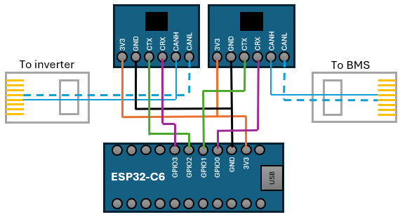
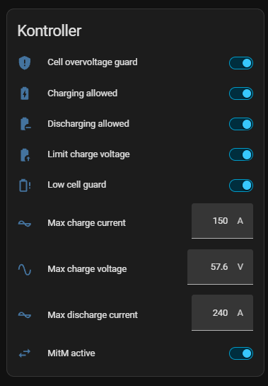
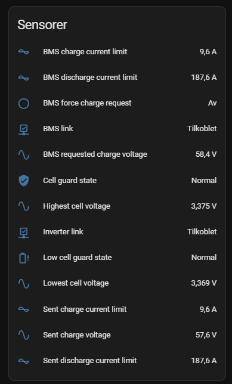
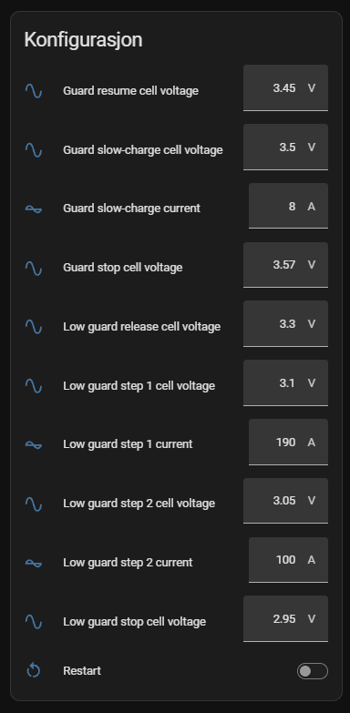
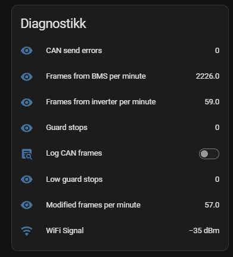

# MitM Deye – safer rewrite

A CAN-bus **man-in-the-middle** for Deye low-voltage batteries and Deye hybrid inverters. An ESP32-C6 sits
between the battery's PCS port and the inverter's BMS port, forwards every frame, and can **lower** the limits
the BMS asks for. It also adds two cell-voltage guards that the Deye BMS lacks.

Running 24/7 since November 2026 on 4 × Deye SE-G5.1 Pro with a SUN-12K-SG04LP3-EU three-phase inverter.

> **WARNING** – This touches the link that protects a large lithium battery. Use it at your own risk.
> The firmware is designed so it can only make the battery *more* conservative, never less, but a wiring
> mistake or a misunderstanding of your system can still cause damage. You are responsible for your installation.

This is a fork of [Psynosaur/MitM-Deye](https://github.com/Psynosaur/MitM-Deye) (itself a fork of
[Adminius/mitpylon](https://github.com/Adminius/mitpylon)), rewritten from scratch.
See [What changed](#what-changed-from-the-original).

## Why

**Top:** the Deye BMS always requests 58.4 V (3.65 V/cell). In a multi-pack system the inverter holds that voltage
until the slowest pack is full, so the other packs sit at the top and hit cell overvoltage (visible as a rising
"Overcharge Count" on each pack). Deye's own settings cannot lower the charge voltage in lithium mode. This device can,
and the cell overvoltage guard slows or stops charging when one cell runs ahead.

**Bottom:** at high discharge current (about 60 A per pack) the cells sag 90–140 mV. Near empty this makes single
cells dip to ~3.05 V or lower under load, and the BMS then corrects its SOC downwards on some packs but not others,
so the packs drift apart. The low cell guard trims the discharge current in steps before that happens.
This helps when the battery is used in winter to buy power at a fixed price and sell it when the hourly price is high,
which means hard cycling of the packs.

## What it does

| Feature | How |
|---|---|
| Lower charge voltage (CVL) | `0x351` bytes 0–1, `min(BMS, setting)` |
| Lower charge / discharge current (CCL / DCL) | `0x351` and `0x371`, `min(BMS, setting)` |
| Disable charging / discharging | clears the enable bits in `0x35C` (never sets a bit) |
| **Cell overvoltage guard** | highest cell (`0x361`) ≥ 3.50 V → charge current down to 8 A; ≥ 3.57 V → charging stopped for at least 15 min, then slow charge again once below 3.45 V; back to normal after 30 min below 3.40 V |
| **Low cell guard** (stepwise) | lowest cell (`0x361`) below 3.10 V for 10 s → DCL step 1; below 3.05 V → step 2; below 2.95 V → discharge stopped; back to normal only after a charge (above 3.30 V for 10 min) |

Everything else (SOC, alarms, cell data, the inverter's `0x305` heartbeat) passes through untouched,
in both directions, for any number of packs.

### Safety rules built into the code

- **Only downwards.** Every change is `min(what the BMS asked, your setting)`. Nothing can be raised.
- **Fail-safe.** No frames from the BMS → nothing is sent → the inverter sees "BMS lost" and stops.
- **BMS force-charge wins.** If the BMS requests force charge (cells critically low), your charge settings are ignored.
- **Guards fail open.** If cell data (`0x361`) is missing for 30 s or outside 2.0–4.0 V, the guards do nothing and
  the BMS's own protection still applies.
- **No flapping.** The low guard needs 10 s below a threshold before it acts (load spikes are ignored), and it only
  steps down while the battery is low. It does not step back up between steps.
- **Off by default.** First boot is pure pass-through ("MitM active" off). Both guards are off until you switch them on.

## Hardware

- ESP32-C6 (it has **two** TWAI/CAN controllers). Tested on an ESP32-C6 Super Mini.
- 2 × CAN transceiver, one per bus:
  - **SN65HVD230 (VP230)** on 3.3 V, Rs pin to GND, or
  - **TJA1051 with VIO** (VCC 5 V, VIO 3.3 V, S to GND).
  - Avoid TJA1050/HV021 unless you add a level shifter (their TXD needs ~3.5 V high).
- Each side is its own bus: fit the **120 Ω terminator on both modules**.

| Signal | Pin |
|---|---|
| BMS side TX / RX (battery "PCS" port) | GPIO0 / GPIO1 |
| Inverter side TX / RX (inverter "BMS" port) | GPIO20 / GPIO19 |

Pins are substitutions at the top of `deye-mitm.yaml`. Avoid strapping and USB pins (see the comments there).

Wiring overview from the original project (pin numbers differ, use the table above):

The Deye PCS CAN protocol document is in
[`docs/`](docs/PCS%20CAN-Bus-protocol-DY-low-voltage%20V3.3.zh-CN.en.pdf).

## Install

1. Copy `deye-mitm.yaml` and the `mitm/` folder into your ESPHome config directory.
2. Create `secrets.yaml` from `secrets.example.yaml` (generate a new API key; use long random passwords).
3. Optional: flash `test/mitm-cantest.yaml` first. It checks that both transceivers send and receive.
4. Flash `deye-mitm.yaml`, add the device in Home Assistant, and check that **BMS link** and **Inverter link** are
   connected and **CAN send errors** stays at 0. With MitM off, "Sent …" must equal "BMS …".
5. Only then switch on **MitM active**, set your limits, and switch on the guards you want.

Tested with ESPHome 2026.10 (ESP-IDF framework).

## Home Assistant

All currents are **totals for the whole battery** (all packs together), not per pack.
The screenshots are from a Norwegian Home Assistant (Kontroller = Controls, Sensorer = Sensors,
Konfigurasjon = Configuration, Diagnostikk = Diagnostics) and show the settings used on the 4-pack system.

| Controls | Sensors |
|---|---|
|  |  |

| Configuration | Diagnostics |
|---|---|
|  |  |

### Controls

| Entity | Default | Meaning |
|---|---|---|
| MitM active | off | Master switch. Off = pure pass-through |
| Limit charge voltage / Max charge voltage | on / 56.8 V | Lower CVL. 57.6–58.0 V works well on 16S; much lower and the inverter tapers early and the packs never balance |
| Max charge current / Max discharge current | 400 A | Upper limits (the BMS value is used if lower) |
| Charging allowed / Discharging allowed | on | Clear the enable bits |
| Cell overvoltage guard | off | Enables the top guard |
| Low cell guard | off | Enables the bottom guard. Turn it off for capacity tests to the bottom |

### Configuration

| Entity | Default | Meaning |
|---|---|---|
| Guard slow-charge cell voltage / current | 3.50 V / 8 A | Top guard: charge current down to this |
| Guard stop / resume cell voltage | 3.57 V / 3.45 V | Top guard: stop charging; resume (slowly) after the pause once below this |
| Low guard step 1 cell voltage / current | 3.10 V / 190 A | First, mild cut |
| Low guard step 2 cell voltage / current | 3.05 V / 40 A | Second cut. 0 A = clean stop; the screenshot uses 100 A to keep exporting |
| Low guard stop cell voltage | 2.95 V | Discharge stopped (DCL 0 and discharge enable off) |
| Low guard release cell voltage | 3.30 V | Back to normal after 10 min above this (needs a charge) |

### Sensors and diagnostics

| Entity | Meaning |
|---|---|
| BMS link / Inverter link | Frames seen from each side in the last 5 s |
| BMS … / Sent … (charge voltage, charge and discharge current limit) | What the BMS asked vs what the inverter got |
| BMS force charge request | The BMS asks for force charge (your charge settings are then ignored) |
| Cell guard state / Low cell guard state | Off, Normal, Slow charge, Charge stopped / Reduced discharge step 1, step 2, Discharge stopped, No cell data |
| Highest / Lowest cell voltage | From `0x361` (all packs) |
| Guard stops / Low guard stops | How many times each guard has stopped charging / discharging since boot |
| Frames from BMS / inverter per minute, Modified frames per minute | About 2 200 / 60 / 60 on a 4-pack system |
| CAN send errors | Should stay at 0. If it rises: wiring, termination or a transceiver |
| Log CAN frames | Logs every frame (~40 lines/s). Troubleshooting only |

Tip: a Home Assistant automation that turns **Limit charge voltage** off for a few hours every week or month
lets the BMS reach 100 % for balancing and SOC calibration.

## Tuning notes (from the 4 × SE-G5.1 Pro system)

- **Charge voltage:** 56.7 V was too low (the inverter tapered early, packs stopped at ~97 % and never balanced).
  57.6–58.0 V lets the BMS balance while the overvoltage guard catches the cell that runs ahead.
- **Low guard steps:** at ~60 A per pack, step 1 (190 A total, ~47 A per pack) lifted the cells about 15 mV and was
  enough to keep them above 3.05 V down to the inverter's 10 % SOC stop. Exporting at full power was the goal, so
  step 2 is set high (100 A) instead of trickling out at 1–2 kW.
- **Release after a charge:** an LFP cell rests at ~3.26 V around 20 % SOC, so the release voltage (3.30 V) is
  above that on purpose. Otherwise the guard would release at rest and pump on and off.

## What changed from the original

The original was a good proof of concept but unsafe for some systems: overrides could exceed the BMS limits,
force-charge could be blocked, SOC came from Home Assistant sensors, only packs 1–2 were passed through, and
`0x305` never reached the BMS. This version:

- forwards every frame in both directions for any number of packs, including `0x305`
- only changes `0x351`, `0x371` and `0x35C`, and only downwards
- never touches SOC (`0x355`)
- adds the cell overvoltage guard and the stepwise low cell guard
- adds link, frame-rate and send-error diagnostics, and a CAN bench test
- splits the logic into a plain C++ header (`mitm/mitm_deye.h`) that can be read and tested on its own

## License

Apache License 2.0, same as the original. See [`LICENSE`](LICENSE) and [`NOTICE`](NOTICE).
